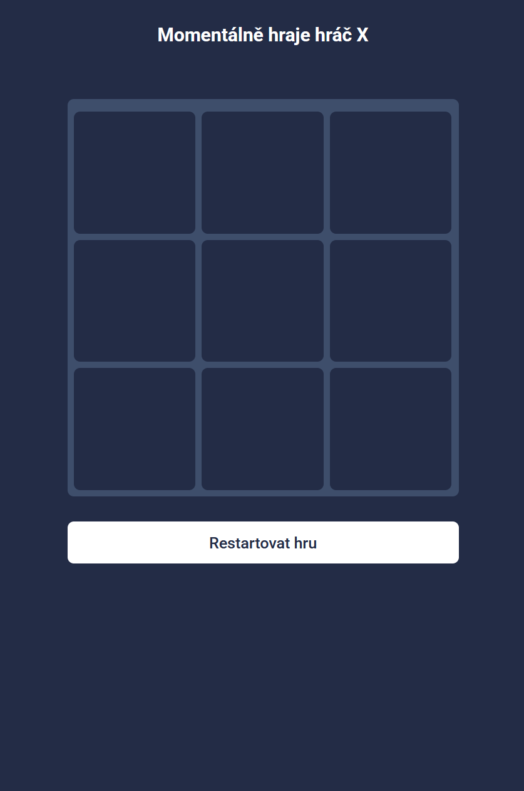

# Tic Tac Toe
Můj první projekt v Reactu, po několika letech v Angularu. Tak zkouším vývíjet Reactu. Na půl dělané za pomocí tutoriálu podle [tohoto tutoriálu](https://react.dev/learn/tutorial-tic-tac-toe) a vzhled inspirovaný podle [tohoto obrázku](https://dribbble.com/shots/23082700-Tic-Tac-Toe-App).

## Fotka z aplikace
